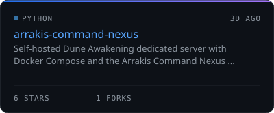
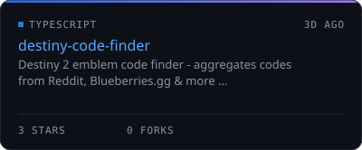
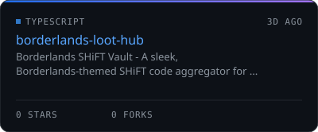
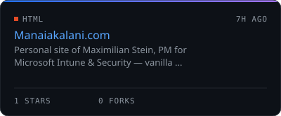
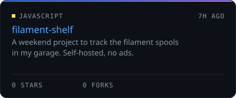
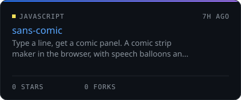
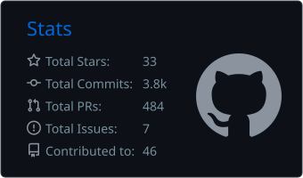
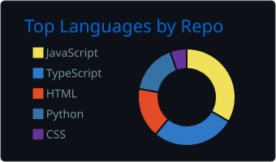

<div align="center">

<picture>
  <source media="(prefers-color-scheme: dark)" srcset="./assets/header.svg" />
  <source media="(prefers-color-scheme: light)" srcset="./assets/header-light.svg" />
  
</picture>

<em>🌺 Island roots · ☁️ Cloud ambitions · 🤙🏽 Always shipping</em>

Redmond, WA · Microsoft · he/him


[](https://linkedin.com/in/manaiakalani) [](https://bsky.app/profile/did:plc:kurxpumma6piictgpr424wcj) [](https://x.com/manaiakalani) [](https://www.twitch.tv/manaiakalani) [](https://www.youtube.com/@Manaiakalani206) [](https://manaiakalani.com)

</div>

<picture>
  <source media="(prefers-color-scheme: dark)" srcset="./assets/wave.svg" />
  <source media="(prefers-color-scheme: light)" srcset="./assets/wave-light.svg" />
  
</picture>

### 🤙🏽 &nbsp;About

```yaml
name: Maximilian (Manaiakalani) Stein
role: Product Manager @ Microsoft
work: github.com/MaxSteinMS
vibes: 🌺 Hawaiian roots · 🌲 PNW life · 🐕 doge · 🌮 tacos · 😂 memes
```

### ⭐ &nbsp;Featured projects

<table>
  <tr>
    <td width="50%" valign="top" align="center">
      <a href="https://github.com/Manaiakalani/auracast">
        
      </a>
      <br />
      <strong><a href="https://github.com/Manaiakalani/auracast">AuraCast</a></strong>
      <br />
      AuraCast -- open-source web app for E87 / L8 round LED smart badges. Upload images, GIFs, patterns, text, and animations via Web Bluetooth. No app, no cable, no account.
      <br />
      <a href="https://github.com/Manaiakalani/auracast">Repo</a>
      ·
      <a href="https://manaiakalani.github.io/auracast/">Live demo</a>
    </td>
    <td width="50%" valign="top" align="center">
      <a href="https://github.com/Manaiakalani/arrakis-command-nexus">
        
      </a>
      <br />
      <strong><a href="https://github.com/Manaiakalani/arrakis-command-nexus">Arrakis Command Nexus</a></strong>
      <br />
      Self-hosted Dune Awakening dedicated server with Docker Compose and the Arrakis Command Nexus companion dashboard
      <br />
      <a href="https://github.com/Manaiakalani/arrakis-command-nexus">Repo</a>
    </td>
  </tr>
  <tr>
    <td width="50%" valign="top" align="center">
      <a href="https://github.com/Manaiakalani/destiny-code-finder">
        
      </a>
      <br />
      <strong><a href="https://github.com/Manaiakalani/destiny-code-finder">Destiny Code Finder</a></strong>
      <br />
      Destiny 2 emblem code finder - aggregates codes from Reddit, Blueberries.gg &amp; more. Privacy-first, no tracking.
      <br />
      <a href="https://github.com/Manaiakalani/destiny-code-finder">Repo</a>
      ·
      <a href="https://manaiakalani.github.io/destiny-code-finder/">Live demo</a>
    </td>
    <td width="50%" valign="top" align="center">
      <a href="https://github.com/Manaiakalani/DuneBox">
        
      </a>
      <br />
      <strong><a href="https://github.com/Manaiakalani/DuneBox">DuneBox</a></strong>
      <br />
      🏜️ DuneBox - An epic AR sandbox with GPU water simulation, creatures, and custom themes. C++/OpenFrameworks.
      <br />
      <a href="https://github.com/Manaiakalani/DuneBox">Repo</a>
      ·
      <a href="https://manaiakalani.github.io/DuneBox-docs/">Docs</a>
    </td>
  </tr>
  <tr>
    <td width="50%" valign="top" align="center">
      <a href="https://github.com/Manaiakalani/cards-against-ai">
        
      </a>
      <br />
      <strong><a href="https://github.com/Manaiakalani/cards-against-ai">Cards Against AI</a></strong>
      <br />
      Cards Against AI - the party game for chronically online people
      <br />
      <a href="https://github.com/Manaiakalani/cards-against-ai">Repo</a>
      ·
      <a href="https://manaiakalani.github.io/cards-against-ai/">Live demo</a>
    </td>
    <td width="50%" valign="top" align="center">
      <a href="https://github.com/Manaiakalani/mascot-mate">
        
      </a>
      <br />
      <strong><a href="https://github.com/Manaiakalani/mascot-mate">mascot-mate</a></strong>
      <br />
      Embeddable web mascot widget - Clippy, Ninja Cat &amp; Bob meet OpenAI streaming. Drag, ask, swap. Trademarks © their respective owners.
      <br />
      <a href="https://github.com/Manaiakalani/mascot-mate">Repo</a>
      ·
      <a href="https://manaiakalani.github.io/mascot-mate">Live demo</a>
    </td>
  </tr>
</table>

### 🔨 &nbsp;Currently Building

<!-- CURRENTLY_BUILDING:START -->
<!-- generated by .github/scripts/update_currently_building.py; do not edit -->
<div align="center">

<a href="https://github.com/Manaiakalani/arrakis-command-nexus">
  <picture>
    <source media="(prefers-color-scheme: dark)" srcset="https://raw.githubusercontent.com/manaiakalani/manaiakalani/projects/arrakis-command-nexus-dark.svg" />
    <source media="(prefers-color-scheme: light)" srcset="https://raw.githubusercontent.com/manaiakalani/manaiakalani/projects/arrakis-command-nexus-light.svg" />
    
  </picture>
</a>&nbsp;
<a href="https://github.com/Manaiakalani/destiny-code-finder">
  <picture>
    <source media="(prefers-color-scheme: dark)" srcset="https://raw.githubusercontent.com/manaiakalani/manaiakalani/projects/destiny-code-finder-dark.svg" />
    <source media="(prefers-color-scheme: light)" srcset="https://raw.githubusercontent.com/manaiakalani/manaiakalani/projects/destiny-code-finder-light.svg" />
    
  </picture>
</a>
<br/>
<a href="https://github.com/Manaiakalani/borderlands-loot-hub">
  <picture>
    <source media="(prefers-color-scheme: dark)" srcset="https://raw.githubusercontent.com/manaiakalani/manaiakalani/projects/borderlands-loot-hub-dark.svg" />
    <source media="(prefers-color-scheme: light)" srcset="https://raw.githubusercontent.com/manaiakalani/manaiakalani/projects/borderlands-loot-hub-light.svg" />
    
  </picture>
</a>&nbsp;
<a href="https://github.com/Manaiakalani/Manaiakalani.com">
  <picture>
    <source media="(prefers-color-scheme: dark)" srcset="https://raw.githubusercontent.com/manaiakalani/manaiakalani/projects/Manaiakalani.com-dark.svg" />
    <source media="(prefers-color-scheme: light)" srcset="https://raw.githubusercontent.com/manaiakalani/manaiakalani/projects/Manaiakalani.com-light.svg" />
    
  </picture>
</a>
<br/>
<a href="https://github.com/Manaiakalani/filament-shelf">
  <picture>
    <source media="(prefers-color-scheme: dark)" srcset="https://raw.githubusercontent.com/manaiakalani/manaiakalani/projects/filament-shelf-dark.svg" />
    <source media="(prefers-color-scheme: light)" srcset="https://raw.githubusercontent.com/manaiakalani/manaiakalani/projects/filament-shelf-light.svg" />
    
  </picture>
</a>&nbsp;
<a href="https://github.com/Manaiakalani/sans-comic">
  <picture>
    <source media="(prefers-color-scheme: dark)" srcset="https://raw.githubusercontent.com/manaiakalani/manaiakalani/projects/sans-comic-dark.svg" />
    <source media="(prefers-color-scheme: light)" srcset="https://raw.githubusercontent.com/manaiakalani/manaiakalani/projects/sans-comic-light.svg" />
    
  </picture>
</a>

</div>
<!-- CURRENTLY_BUILDING:END -->

<picture>
  <source media="(prefers-color-scheme: dark)" srcset="./assets/wave.svg" />
  <source media="(prefers-color-scheme: light)" srcset="./assets/wave-light.svg" />
  
</picture>

### 📊 &nbsp;Analytics

<div align="center">
  <picture>
    <source media="(prefers-color-scheme: dark)" srcset="https://raw.githubusercontent.com/manaiakalani/manaiakalani/stats/github_dark/3-stats.svg" />
    <source media="(prefers-color-scheme: light)" srcset="https://raw.githubusercontent.com/manaiakalani/manaiakalani/stats/default/3-stats.svg" />
    
  </picture>
  <picture>
    <source media="(prefers-color-scheme: dark)" srcset="https://raw.githubusercontent.com/manaiakalani/manaiakalani/stats/github_dark/1-repos-per-language.svg" />
    <source media="(prefers-color-scheme: light)" srcset="https://raw.githubusercontent.com/manaiakalani/manaiakalani/stats/default/1-repos-per-language.svg" />
    
  </picture>
</div>

### 🐍 &nbsp;Contribution Snake

<div align="center">
  <picture>
    <source media="(prefers-color-scheme: dark)" srcset="https://raw.githubusercontent.com/manaiakalani/manaiakalani/output/github-contribution-grid-snake-dark.svg" />
    <source media="(prefers-color-scheme: light)" srcset="https://raw.githubusercontent.com/manaiakalani/manaiakalani/output/github-contribution-grid-snake.svg" />
    
  </picture>
</div>

<picture>
  <source media="(prefers-color-scheme: dark)" srcset="./assets/footer.svg" />
  <source media="(prefers-color-scheme: light)" srcset="./assets/footer-light.svg" />
  
</picture>
